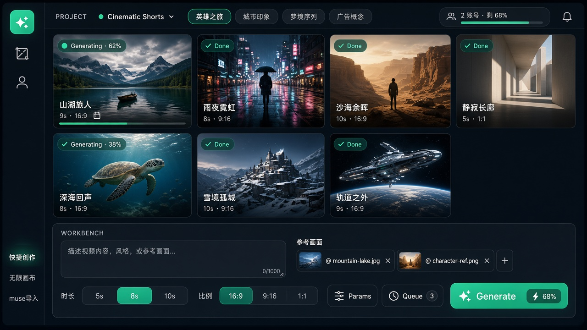
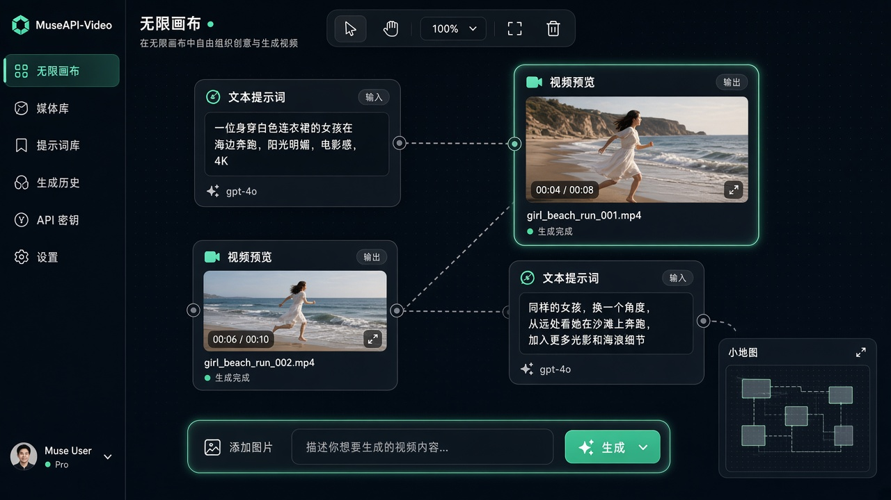
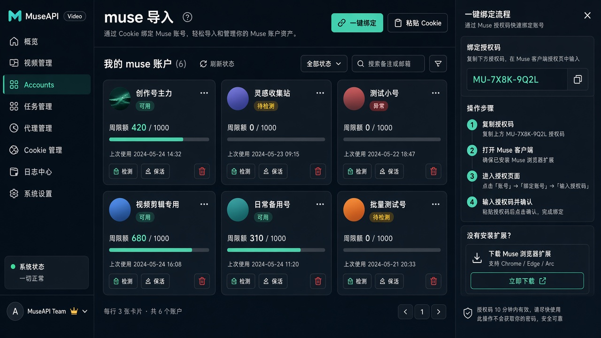

# MuseAPI-Video · AI 视频创作平台

把 **muse.ai** 的网页端能力包装成可自托管的视频创作站：导入 muse 账号 → 用账号池额度生成视频 → 在画布上编排。全部跑在本机，不依赖第三方云服务。

上游复用开源项目 [muse2api](https://github.com/czg86389-hub/muse2api)（把 muse.ai 逆向封成 OpenAI 兼容 API，靠无头 Chrome + CDP 驱动网页端）。本仓库在它之上补了平台层。

```
┌──────────────┐   HTTP    ┌─────────────────┐   HTTP    ┌──────────────┐  CDP  ┌────────┐  HTTPS  ┌──────────┐
│  浏览器 web/  │ ────────► │ 平台 server/     │ ────────► │ 上游 muse2api │ ────► │ Chrome │ ──────► │ muse.ai  │
│  React SPA   │   :8787   │ Node + SQLite    │  :18610   │ FastAPI      │ :19210│ 无头   │         │ 网页端    │
└──────────────┘           │ 任务/账号/作品    │           │ 账号池/生成   │       └────────┘         └──────────┘
                           └─────────────────┘           └──────────────┘
```

- **上游**：负责「怎么让 muse.ai 真的生成出东西」——浏览器驱动、Cookie 会话、附件上传、结果抓取。
- **平台**：负责「怎么用得顺」——登录、账号导入与额度、任务编排、画面预览、画布。

两层解耦。升级上游只需 `cd upstream/muse2api && git pull`，不影响平台代码。

---

## 产品原型

深色创作台风格：底色 `#0a0d16`，薄荷绿 `#0fa98a → #4fe3c1` 点缀；细侧栏只保留三个入口。当前界面已按这三张原型重做。

<table>
  <tr>
    <td colspan="2" align="center">
      <br>
      <b>快捷创作</b> · 项目栏 + 任务网格 + 底部 WORKBENCH（提示词 / 参考画面 / 时长 / 比例 / Params / Queue / Generate）
    </td>
  </tr>
  <tr>
    <td width="50%" align="center">
      <br>
      <b>无限画布</b> · 点状网格、玻璃节点、悬浮生成条、小地图
    </td>
    <td width="50%" align="center">
      <br>
      <b>muse 导入</b> · 账号卡片 + 周额度 + 右侧一键绑定流程
    </td>
  </tr>
</table>

---

## 快速开始

### 环境

- Windows 10/11（也支持 Linux / macOS；启停脚本目前是 PowerShell）
- Node.js 20+（本机实测 24.13）
- Python 3.11（`upstream/muse2api`）
- Chrome（装在默认路径即可，上游会自动探测）

### 克隆与启动

```powershell
git clone https://github.com/LIUFelix2004/museAPI-video.git
cd museAPI-video

.\start.ps1          # 启动上游 + 平台
.\start.ps1 -Build   # 改过前端后，先构建再启动
.\stop.ps1           # 全部停止
```

首次运行会自动创建 Python venv、安装依赖、打包扩展，等它跑完即可。

### 打开

| 入口 | 地址 |
|---|---|
| 平台 | <http://127.0.0.1:8787> |
| 上游面板（调试用） | <http://127.0.0.1:18610/admin?key=m2a_muse_studio_local_2026> |

默认管理员：`admin@muse.local` / `admin123456`

> 对外暴露前，务必改掉 `server/.env` 里的 `ADMIN_PASSWORD` 和 `JWT_SECRET`。

---

## 功能

| 功能 | 路由 | 说明 |
|---|---|---|
| **快捷创作** | `/create` | 项目栏 + 作品网格 + WORKBENCH：提示词、**参考素材（图/视频）**、时长/画幅、参数面板、任务队列、**灵感库** |
| **无限画布** | `/canvas` | 节点拖拽、缩放平移、多选删除、双击改文本、自动保存、节点级生成 |
| **muse 导入** | `/accounts` | **四种导入方式**（自动导入 / 一键绑定 / 粘贴 / 上游直连）、额度查询、检测、保活、删除 |

登录后直接进入 `/create`，侧栏只有这三项。

> 其余页面（首页、论坛、会员、充值、邀请、团队、API 平台、设置、历史、运营后台）已下线，源码仍在 `web/src/pages/`。需要时在 `App.jsx` 里加回 import 和 Route 即可。

---

## 账号导入（重点）

**没有导入账号，平台什么都生成不了。** 平台本身不产生内容，只是把你的 muse.ai 账号变成可调用的生成能力——每次点「生成」，上游都会用你导入的账号去 muse.ai 网页端跑一遍。

### 为什么不能直接复制 Cookie

muse.ai 的登录态主要靠 `hatch_sess`，它是 **HttpOnly** Cookie：

- 在页面里执行 `document.cookie` —— **读不到它**
- DevTools → Application 能看到它，但那是浏览器内部视图，网页 JS 访问不到

想拿到它，有四条路：**CDP 调试协议**（让浏览器自己交出来）、**浏览器扩展**（能读 HttpOnly）、**从网络请求头里抄**、或 **让上游自己的浏览器登录一次**。下面四种导入方式对应这四条路。

### 四种方式对比

| 方式 | 是否手拷 Cookie | 需要什么 | 适合 |
|---|---|---|---|
| **一、自动导入**（最省事） | 不用 | 本机 Chrome，或指纹浏览器开着调试端口 | 本机已有登录态，管理员操作 |
| **二、一键绑定** | 不用 | 装一次浏览器扩展 | 通用，跨机器 |
| **三、手动粘贴** | 要，从 Network 面板抄 | 会用 DevTools | 兜底，不想装任何东西 |
| **四、上游面板直连** | 不用 | 上游 key | 调试，或用上游自带导号工具 |

---

### 方式一：自动导入（推荐，零操作）

原理：平台直接连浏览器的 **CDP 调试端口**，用 `Storage.getCookies` 读出**全部** Cookie（包括 HttpOnly 的 `hatch_sess`）→ 提交给上游入库。全程不开 F12、不装扩展。

#### 两个入口

打开 **muse 导入 → 自动导入**，弹窗里有两个标签：

**A. 本机 Chrome（可多环境）**

适合一台机器上开着多个 Chrome profile 的情况。

1. 下拉里会列出本机所有 profile（含名称和最后使用时间）
2. 选中你登录 muse.ai 的那个环境
3. 点 **「重启 Chrome 并导入」**

⚠️ 首次使用会**关闭当前所有 Chrome 窗口**（同一 profile 不能开两个实例带调试端口），然后用 `--restore-last-session` 重启，标签页会恢复。之后调试端口一直开着，再导入就不用重启了。

**B. 自定义端口（指纹浏览器）**

适合 AdsPower、BitBrowser 这类多账号浏览器。

1. 先在指纹浏览器里**启动目标环境**
2. 回到平台点 **「扫描本机」** —— 会自动列出所有正在监听的 CDP 端口，并**标出哪个有 muse 登录态**
3. 点选那个端口（或手动填），点 **「连接并导入」**

扫描结果大概长这样：

```
port 1524   Chrome/151.0.7922.47   有 muse 登录态
port 56312  Chrome/151.0.7922.47   未登录 muse
```

#### 常用操作

- **扫描本机**：列出所有 CDP 端口，优先选中带 muse 登录态的那个
- **重新检查**：刷新端口和 Chrome 运行状态
- **关闭调试模式**：把 Chrome 恢复成不带端口的普通启动（导入完成后建议点一下）

> **安全提示**：调试端口只绑定 `127.0.0.1`，外网访问不到；但开启期间**本机任何程序都能读到该浏览器的 Cookie**。导入完建议关掉。

#### 常见报错

| 提示 | 原因 |
|---|---|
| 读不到 N 端口的 Cookie：调试端口未就绪 | 没有浏览器以调试模式运行，先让 Chrome「重启」或启动指纹浏览器环境 |
| 这个 Chrome 里没有 muse.ai 的 Cookie | 选错了 profile，或该环境没登录 muse.ai |
| 读到 Cookie 但没有 hatch_sess | 登录态已失效，重新登录后再导 |

---

### 方式二：一键绑定（跨机器通用）

原理：平台页面生成一次性绑定码 → 扩展在浏览器里读出 muse.ai 的全部 Cookie（含 HttpOnly）→ 提交给平台 → 平台转给上游入库。

和方式一的区别：**不需要重启浏览器，也不需要本机可访问**，适合给远程的人用。


#### 第 1 步：安装扩展（只需一次）

1. 打开平台 → 左侧 **muse 导入** → 点右上角 **「一键绑定」**
2. 在弹窗里展开「还没装扩展？」，点 **「下载扩展包 (.zip)」**  
   （也可以直接用仓库里的 `extension/` 目录）
3. 解压到一个**不会被删**的固定位置
4. Chrome 地址栏输入 `chrome://extensions`
5. 打开右上角 **「开发者模式」**
6. 点 **「加载已解压的扩展程序」**，选刚才解压出来的文件夹
7. 工具栏出现扩展图标即成功

> 更新过扩展代码后，要回 `chrome://extensions` 点一次「重新加载」，否则浏览器还在跑旧代码。

#### 第 2 步：确保这个浏览器已登录 muse.ai

打开 <https://muse.ai/>，能看到聊天界面即可。

**扩展读的是「你点绑定按钮的那个浏览器」里的登录态，不是服务器上的。** 若在 A 电脑装扩展、在 B 电脑登录 muse.ai，绑不上。

#### 第 3 步：绑定

两种走法任选其一：

**走法 A（自动）**

1. 平台点 **「一键绑定」** → 生成绑定码
2. 点弹窗里的 **「打开」**（跳到 `/bind/<码>`）
3. 扩展检测到绑定码 → 自动读 Cookie → 提交 → 页面显示「绑定成功」

**走法 B（手动填码，适合给第二个账号用）**

1. 平台点 **「一键绑定」**，复制 **绑定码**
2. 点浏览器工具栏的扩展图标
3. 三个框这样填：

   | 框 | 填什么 |
   |---|---|
   | 平台地址 | `http://127.0.0.1:8787`（部署在服务器就填服务器地址） |
   | 绑定码 | 刚才复制的那个 |
   | 备注名 | 随便，比如「主号」，可留空 |

4. 点 **「读取并绑定」**

> 绑定码 **20 分钟有效**，且只能用一次。过期了就回平台重新点「一键绑定」。多账号请各自生成新码。

#### 一键绑定失败排查

| 提示 | 原因 | 怎么办 |
|---|---|---|
| 没有读到 Cookie | 当前浏览器没登录 muse.ai | 先登录再试 |
| 读到 N 条但没有 hatch_sess | 登录态不对或已失效 | 重新登录 muse.ai |
| 该绑定码已使用过 | 重复提交 | 重新生成一个码 |
| 绑定码已过期 | 超过 20 分钟 | 重新生成一个码 |
| 扩展没有响应 | 扩展被禁用 / 页面没刷新 | 在 `chrome://extensions` 确认已启用，再刷新页面 |

---

### 方式三：手动粘贴 Cookie

不想装扩展，或只想临时加个账号时用这个。

#### 需要哪些 Cookie

| Cookie | 必要性 | 说明 |
|---|---|---|
| **`hatch_sess`** | **必须有** | 登录会话本身，缺它平台会直接拒绝 |
| `hatch_vml` | 强烈建议 | 决定账号剩余有效期（约 48 小时） |
| `hatch_gw` | 可选 | 路由缓存，上游会自己重新签发 |
| 其他（`datr`、`dpr`、`theme`、`wd`、`_fbp`…） | 不需要 | 与登录态无关 |

#### ✅ 推荐：从 Network 面板复制完整 Cookie 头

一次复制全部，格式天然正确，最不容易出错。

1. 在已登录 muse.ai 的标签页按 `F12`
2. 切到 **Network**
3. 按 `F5` 刷新
4. 点任意一条发往 `muse.ai` 的请求（例如 `graphql`）
5. 右侧 **Headers** → **Request Headers**
6. 找到以 `cookie:` 开头的那一行
7. **右键 → Copy value**
8. 回到平台 → 「muse 导入」→ **「粘贴」** → 粘贴 → 起备注名 → 导入

复制出来大概长这样：

```
hatch_sess=eyJhbGciOi...; hatch_vml=v1%3A...; hatch_native_auth_device=...; datr=...; _fbp=...
```

#### ❌ 不推荐：在 Application → Cookies 表格里逐个复制

能用，但容易出错：

1. 表格里的值常被截断，`hatch_sess` 可能要往下滚才看得见
2. 点 Value 只能一次复制一个，还得自己补 `名字=` 前缀、拼分号
3. 漏掉 `hatch_vml` 会让有效期估算不准

如果只能从表格抄，最少要这两个，并手工拼成：`hatch_sess=值; hatch_vml=值`

- `hatch_sess`（表格里可能显示成 `hatch_s...`，800+ 字节的那行）
- `hatch_vml`（紧挨着的下一行）

#### 粘贴时的容错

平台解析比较宽松，下面这些都能吃：

- 带 `Cookie:` 前缀 → 自动去掉
- 多行粘贴 → 自动合并成 `; ` 分隔
- 从表格复制的制表符分隔 → 一般也能识别

但**只复制 Value、不带名字**不行，必须有 `hatch_sess=` 前缀。

---

### 方式四：上游面板直连

也可以在上游管理页直接导号：<http://127.0.0.1:18610/admin>

- **Chrome 扩展**：`upstream/muse2api/extension/`，填服务地址 `http://127.0.0.1:18610` + Key
- **油猴脚本**：`upstream/muse2api/tools/muse2api_cookie_importer.user.js`

这种方式导入的账号归属为空，即「公共池」，平台上所有用户共用。

---

### 账号管理

#### 状态含义

| 状态 | 含义 |
|---|---|
| 可用（绿） | 最近一次检测通过 |
| 待检测（黄） | 刚导入，还没验证过 |
| 异常（红） | 检测失败，多半是 Cookie 过期 |
| 上游已删 | 上游账号池里没有了（在别处删过） |

#### 额度

导入后点账号卡片上的 **「点此查询」**（或页面顶部「刷新」的额度汇总），平台会调上游打开浏览器去 muse.ai 设置页读一次额度，返回：

- **周额度已用百分比**（muse 免费版按周限额）
- **重置日期**
- **额外额度**（通常是「剩余 xx 亿个词元」）

顶栏 `1 账号 · 剩 60%` 就来自这里。多账号时显示平均值；账号页另有「额度合计」（各账号余量相加，例如三个账号剩 60/40/20% → 合计 120%）。

> 额度**不会自动刷新**——查询要开浏览器读页面，比较重。因此是手动触发 + 60 秒本地缓存。

#### 有效期

muse 会话约 **48 小时**。到期后：

- 账号状态会变成「异常」
- 生成请求会返回 401

重新导入一次即可。点 **「保活」** 可让上游尝试续期（不保证成功，取决于上游是否重新签发）。

#### 多账号

账号池按「最久未用」自动轮转，互不阻塞。给每个账号单独生成绑定码即可。

---

## 使用

### 快捷创作 `/create`

**生成一条视频：**

1. 在底部 WORKBENCH 写画面描述
2. 可选：在「参考素材」里上传图片或视频（最多 3 个），正文用 `@` 引用
3. 选时长（5 / 6 / 8 / 10 秒）和画幅（16:9 / 9:16 / 1:1）
4. 点 **「生成」**

任务状态在中间网格实时刷新；完成后可预览、下载、删除。

#### 参考素材（图片 + 视频）

上游支持**图片、视频、音频、文档**混合作为参考，类型按文件头识别。

| 限制 | 值 |
|---|---|
| 素材总数 | 10 个（平台限制为 3 个） |
| 单个大小 | 40 MB |
| 总大小 | 100 MB |
| **视频时长** | **≤ 120 秒** |

平台上传时按 MIME 自动分流：图片进 `images`，视频进 `videos`，音频进 `audios`。
提示词里可以用 `@图` / `@视频` 指代，上游会转成 `[图N]` / `[视频N]` 的编号引用。

> 视频作为参考时，muse 具体怎么利用它（风格参考 / 续写 / 首尾帧）由模型决定，建议先拿短片段试。

#### 灵感库

创作页顶部有 **「作品 / 灵感」** 切换。灵感库融合自
[Awesome-muse-video-prompts-and-skills](https://github.com/imagineVid/Awesome-muse-video-prompts-and-skills)：

- **5 个场景分类**：全部 / 剧情短片 / 产品广告 / 物理与动画 / 沉浸视角
- **9 个经过验证的案例**：每个带完整英文提示词、时长画幅标注、来源署名
- **镜头简报公式**（可折叠）：

```
[DURATION + ASPECT RATIO]. [SUBJECT] performs [VISIBLE ACTION] in [SETTING].
Camera: [FRAMING + MOVE]. Beats: [TIMED ACTIONS].
Audio: [DIALOGUE + FOLEY + AMBIENCE]. Preserve: [IDENTITY / PRODUCT / LAYOUT].
Avoid: [FAILURE MODES].
```

点案例卡片会**同时填入提示词、时长和画幅**——这点很重要，能避免「控件 5s/16:9 但提示词写 9:16/10秒」导致的模型拒答。

> 提示词保留英文原文：Muse Video 是英文模型，原文比译文稳。编辑文本遵循 CC BY 4.0，第三方提示词与创作者署名保留原样。

**参数面板**：WORKBENCH 里的「参数」按钮，可调 Stylize / Chaos / Weird / IW / CW / SW / Seed / Quality，会拼成 `--st 100 --chaos 20` 这类字符串传给上游。

**任务队列**：点「+ 加入自动执行队列」，可按固定间隔自动重复提交同一提示词，支持暂停、恢复、上下移、清理已完成。

### 无限画布 `/canvas`

- 拖动节点、滚轮缩放、空格 / 中键拖动平移
- `Shift` 多选、`Delete` 删除、双击改文本
- 底部输入区写提示词 → 生成结果作为新节点出现
- 改动自动保存到浏览器本地

---

## 目录结构

```
museAPI-video/
├── start.ps1 / stop.ps1     一键启停
├── extension/               浏览器扩展（一键绑定）
│   ├── manifest.json
│   ├── background.js        读 muse.ai Cookie → POST /api/accounts/bind
│   ├── content.js           在 /bind/<码> 页面自动触发
│   └── popup.html/js        手动填码入口
├── upstream/muse2api/       上游引擎（Python FastAPI，未改动）
│   ├── .env                 上游配置（KEY / Chrome 路径 / 超时）
│   └── .venv/
├── server/                  平台后端（Node + SQLite）
│   ├── .env                 JWT / 上游地址 / 管理员
│   ├── public/              扩展打包下载
│   ├── data/                SQLite、媒体、上传（备份就打包这个）
│   └── src/
│       ├── index.js         入口
│       ├── db.js            表结构与读写
│       ├── muse.js          上游客户端（含额度查询）
│       ├── auth.js          登录
│       ├── worker.js        任务轮询 + 队列调度
│       └── routes/
│           ├── accounts.js  账号池 + 一键绑定 + 额度解析
│           ├── chrome.js    CDP 自动导入（多环境 / 端口扫描）
│           ├── generate.js  生成任务（参考素材分流）
│           └── …            auth / queue / chat / v1 …
└── web/                     前端（React + Vite + Tailwind）
    ├── public/fonts/        自托管字体
    └── src/
        ├── pages/           Create / Canvas / Accounts / Login / Bind
        ├── components/      ChromeImportModal（自动导入）/ QueueDrawer / ParamsPanel
        └── data/            inspirations.js（灵感库 + 镜头简报公式）
```

---

## 配置

`server/.env`：

| 变量 | 默认 | 说明 |
|---|---|---|
| `PORT` | 8787 | 平台端口 |
| `MUSE_BASE` | `http://127.0.0.1:18610` | 上游地址 |
| `MUSE_KEY` | `m2a_muse_studio_local_2026` | 上游 key（须与上游 `.env` 一致） |
| `ADMIN_EMAIL` / `ADMIN_PASSWORD` | `admin@muse.local` / `admin123456` | 首次启动创建的管理员 |
| `JWT_SECRET` | 随机 | 登录签名密钥，**生产必换** |

`upstream/muse2api/.env`：

| 变量 | 默认 | 说明 |
|---|---|---|
| `MUSE2API_CHROMIUM` | 自动探测 | Chrome 路径 |
| `MUSE2API_VIDEO_TIMEOUT` | 900 | 视频生成超时（秒） |
| `MUSE2API_CONCURRENCY` | 2 | 最大并发任务数 |

---

## 常见问题

**Q：自动导入点「重启 Chrome 并导入」，会不会丢东西？**  
会关掉当前所有 Chrome 窗口，但用 `--restore-last-session` 重启，标签页会恢复。唯一风险是页面上**没保存的表单**，操作前先存一下。

**Q：自动导入扫不到端口 / 提示「调试端口未就绪」**  
说明当前没有浏览器以调试模式运行。两条路：选「本机 Chrome」标签让平台重启一次；或在 AdsPower / BitBrowser 里先**启动目标环境**，再点「扫描本机」。

**Q：有多个 muse 账号分别在不同环境里，怎么都导进来？**  
每次导入会自动用**环境名**做备注（选「8号」profile 就存成「8号」）。重复操作即可，账号池会按「最久未用」轮转，互不阻塞。

**Q：导入成功了，但点生成提示「没有可用账号」**  
上游账号池为空，或账号状态是「异常」。去 muse 导入页看卡片状态，点「检测」确认。

**Q：DevTools 的 Cookies 里找不到 `hatch_sess`**  
表格按字母排序，`hatch_sess` 在 `hatch_gw`、`hatch_native_auth_device` 下面，往下滚。若确实没有，说明这个浏览器没有登录成功。

**Q：`document.cookie` 里没有 `hatch_sess`**  
正常。它是 HttpOnly，JS 读不到。用自动导入、Network 面板或扩展。

**Q：上传视频后生成失败**  
先看视频是否超过 **120 秒**或 **40 MB**——这两个是上游硬限制。另外视频参考的具体效果取决于 muse，建议先用短片段试。

**Q：生成一直卡在「生成中」**  
上游在跑浏览器，第一次启动 Chrome 会慢一些。超过 15 分钟会自动判失败并退还。若一直不动，看 `upstream/muse2api/server.log`。

**Q：账号只用了几天就「异常」了**  
muse 会话约 48 小时，属正常。重新导入即可。上游有自动保活，能续上时会自动延长期限。

**Q：部署到服务器后打不开或 401**  
检查 `server/.env` 的 `MUSE_BASE` 是否指向上游；Nginx 反代建议放大超时并关闭 buffering：

```nginx
location / {
    proxy_pass http://127.0.0.1:8787;
    proxy_read_timeout 600s;
    proxy_send_timeout 600s;
    proxy_buffering off;
    client_max_body_size 200M;
}
```

**Q：扩展旧版还能用吗**  
绑定通信标识已改为 `museapi-video-ext`。装过旧版的，请在 `chrome://extensions` 点一次「重新加载」，或删掉后重新加载新目录。

---

## 排错时看哪里

| 文件 | 内容 |
|---|---|
| `server/server.log` | 平台日志（任务轮询、队列调度） |
| `server/server.err.log` | 平台异常 |
| `upstream/muse2api/server.log` | 上游日志（浏览器、生成） |
| `upstream/muse2api/server.err.log` | 上游异常 |

平台数据库：`server/data/studio.db`（SQLite）。账号、任务、队列都在这里。

一键体检：

```powershell
node scripts/acceptance.mjs            # 路由 + 接口 + 鉴权边界
node scripts/test-bind.mjs             # 一键绑定链路
node scripts/test-extension-logic.mjs  # 扩展逻辑（沙箱执行 background.js）
```

---

## 许可与致谢

- **上游引擎**：[muse2api](https://github.com/czg86389-hub/muse2api)（MIT），位于 `upstream/muse2api/`，未作修改。
- **灵感库**：编辑文本与分类结构来自
  [Awesome-muse-video-prompts-and-skills](https://github.com/imagineVid/Awesome-muse-video-prompts-and-skills)
  （ImagineVid 编辑内容，[CC BY 4.0](https://creativecommons.org/licenses/by/4.0/)）。
  其中的第三方提示词、创作者署名、商标、图片与视频版权归各自所有者，不在该许可范围内；
  本项目使用时保留了原始提示词文本与创作者来源。
- **字体**：Baloo 2 与 JetBrains Mono，自托管于 `web/public/fonts/`，遵循各自 OFL 许可。
- **平台层**：按仓库内文件约定使用；对外部署请自行遵守 muse.ai 服务条款。